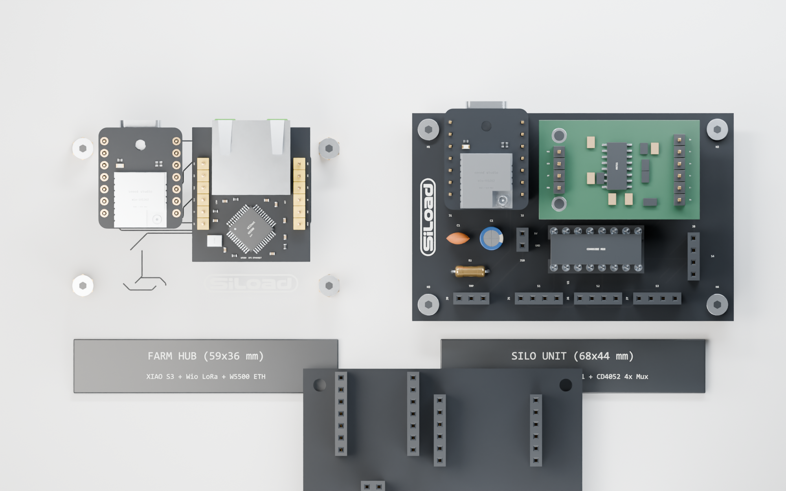

# Siload Hardware Architecture & Pinout (Rev A Carrier PCBs)

| Unit | PCB Directory | Dimensions | Production Gerbers (JLCPCB / PCBWay `.zip`) | Peripherals on Carrier PCB |
|---|---|---|---|---|
| **Farm Hub** (`SILOAD REV A`) | [`hardware/farm_hub/`](farm_hub/) | **59 × 36 mm** | [**`SILOAD-FARM-HUB-REV-A-gerbers.zip`**](farm_hub/SILOAD-FARM-HUB-REV-A-gerbers.zip) ([`gerbers/`](farm_hub/gerbers/)) | W5500 Lite SPI-Ethernet (`J3`/`J4`) + 2-pin 5V power header (`J5`) + decoupling (`C1`, `C2`) |
| **Silo Unit / Load Cell PCB** (`SILOAD LOAD CELL REV A`) | [`hardware/silo_unit/`](silo_unit/) | **68 × 44 mm** | [**`SILOAD-SILO-UNIT-REV-A-gerbers.zip`**](silo_unit/SILOAD-SILO-UNIT-REV-A-gerbers.zip) ([`gerbers/`](silo_unit/gerbers/)) | 1× Horizontal Heemol HX711 (`34 × 21 mm`, `J3`/`J4`) + 1× `CD4052BE` DIP-16 4-ch differential mux (`U1`) + 4× Load Cell headers (`J5`–`J8`) + 1× DS18B20 temp header (`J9`) + 2-pin 5V power header (`J10`) + 4.7 kΩ pull-up (`R1`) |

---

## Why We Departed from the Initial Concept (4× HX711 + XIAO S3 Plus)

The initial draft assumed a **Seeed XIAO ESP32-S3 Plus** (which exposes extra `D11`–`D19` pads on the underside of the module) connected to **4 separate HX711 breakout boards** (requiring 8 GPIO pins just for `DT`/`SCK`).

During hardware design we revised the **Silo Unit (`SILOAD LOAD CELL REV A`)** architecture for three practical reasons:

1. **Standard Seeed XIAO ESP32-S3 (no S3 Plus required):**
   - We use the **standard 14-pin Seeed XIAO ESP32-S3** stacked with the **Wio-SX1262 LoRa addon** on both the **Farm Hub** and the **Silo Unit**.
   - This avoids sourcing a special Plus variant and avoids soldering inaccessible underside SMD pads (`D11`–`D16`), keeping the entire board **100% through-hole** and plug-and-play via female headers (`J1`/`J2`).
2. **Pin budget on the standard 14-pin XIAO + Wio-SX1262 stack:**
   - The stacked Wio-SX1262 LoRa radio uses `D1` (`DIO1`), `D2` (`RESET`), `D3` (`BUSY`), `D4` (`NSS`), `D5` (`RF_SW`), and the SPI bus `D8` (`SCK`), `D9` (`MISO`), `D10` (`MOSI`).
   - That leaves exactly **3 dedicated free GPIOs** on the 14-pin footprint: **`D0` (`GPIO1`)**, **`D6` (`GPIO43`)**, and **`D7` (`GPIO44`)**.
3. **1× Horizontal Heemol HX711 (`34 × 21 mm`) + 1× `CD4052BE` DIP-16 Differential Multiplexer (`U1`):**
   - Instead of 4 separate HX711 boards, we place **1× horizontal Heemol HX711 module (`34 × 21 mm`, ASIN `B0C9QBS2WL`)** connected directly to **`D0` (`HX_DT`)** and **`D6` (`HX_SCK`)**, and the **DS18B20 temperature sensor** on **`D7` (`ONEWIRE_DQ`)** — directly matching `firmware/siload_bench/siload_bench.ino`.
   - Right below the horizontal HX711 sits a single, inexpensive (~€0.25) through-hole **`CD4052BE` / `74HC4052N` DIP-16 dual 4-to-1 differential analog multiplexer (`U1`)** in a 16-pin DIP socket.
   - **Continuous bridge excitation:** All 4 load cells (`J5`–`J8`) receive continuous `E+` and `E-` excitation directly from the HX711 (`J4.6` and `J4.5`), keeping all 4 strain-gauge bridges thermally stable at all times.
   - **Differential signal switching:** The `CD4052BE` switches both differential signal wires `(A+, A-)` of the selected sensor (`J5`–`J8`) simultaneously into the high-impedance differential input `(A+, A-)` of the HX711 (`J4.3` and `J4.4`). Because the HX711 input impedance is extremely high, virtually zero current flows through the multiplexer's internal `R_on`, preventing gain attenuation.
   - **Zero-extra-pin channel selection (`D8` & `D10`):** The two multiplexer address pins `SEL_A` (`U1.10`) and `SEL_B` (`U1.9`) are driven by `D8` (`GPIO7`) and `D10` (`GPIO9`). Whenever `LORA_NSS` (`D4`) is HIGH (i.e. whenever LoRa is not actively transmitting a packet), the SX1262 ignores the SPI clock/MOSI lines completely, allowing the ESP32 to freely select sensor 1 (`00`), 2 (`01`), 3 (`10`), or 4 (`11`).
   - **Ultra-compact footprint:** Dropping 3 redundant HX711 modules and placing the `34 × 21 mm` HX711 and `CD4052BE` horizontally shrinks the entire Silo Unit PCB to just **`68 × 44 mm`**.

---

## 1. Silo Unit (`SILOAD LOAD CELL REV A` — `68 × 44 mm`)

| 3D Studio Render | Top Orthographic View |
|---|---|
|  |  |

### XIAO ESP32-S3 + Wio-SX1262 Pinout (`J1` / `J2`)

| XIAO Pin | GPIO | Net Name | Function / Carrier Connection |
|---|---|---|---|
| **D0** (`J1.1`) | `GPIO1` | `HX_DT` | **HX711 Data (`DT`)** → `J3.3` |
| **D1** (`J1.2`) | `GPIO2` | *(NC on PCB)* | **LoRa `DIO1`** (internal to stacked Wio-SX1262) |
| **D2** (`J1.3`) | `GPIO3` | *(NC on PCB)* | **LoRa `RESET`** (internal to stacked Wio-SX1262) |
| **D3** (`J1.4`) | `GPIO4` | *(NC on PCB)* | **LoRa `BUSY`** (internal to stacked Wio-SX1262) |
| **D4** (`J1.5`) | `GPIO5` | *(NC on PCB)* | **LoRa `NSS` (CS)** (internal to stacked Wio-SX1262; keep HIGH during sensor reads) |
| **D5** (`J1.6`) | `GPIO6` | *(NC on PCB)* | **LoRa `RF_SW`** (internal to stacked Wio-SX1262) |
| **D6** (`J1.7`) | `GPIO43` | `HX_SCK` | **HX711 Serial Clock (`SCK`)** → `J3.2` |
| **5V** (`J2.1`) | — | `+5V` | 5 V power rail on XIAO → connected to 2-pin external power input header `J10.1` |
| **GND** (`J2.2`) | — | `GND` | Digital & analog ground → `J3.4`, `U1.6` (`INH`), `U1.7` (`VEE`), `U1.8` (`VSS`), `J9.3`, `J10.2`, `C1.2`, `C2.2` |
| **3V3** (`J2.3`) | — | `+3V3` | Regulated 3.3 V supply → `J3.1` (`VCC`), `U1.16` (`VDD`), `J9.1` (`VDD`), `R1.1`, `C1.1`, `C2.1` |
| **D10** (`J2.4`) | `GPIO9` | `MUX_B` | **CD4052 Select B (`SEL_B`, bit 1)** → `U1.9` (shared with LoRa MOSI when `D4` is LOW) |
| **D9** (`J2.5`) | `GPIO8` | *(NC on PCB)* | **LoRa `SPI MISO`** (internal to stacked Wio-SX1262) |
| **D8** (`J2.6`) | `GPIO7` | `MUX_A` | **CD4052 Select A (`SEL_A`, bit 0)** → `U1.10` (shared with LoRa SCK when `D4` is LOW) |
| **D7** (`J2.7`) | `GPIO44` | `ONEWIRE_DQ` | **DS18B20 1-Wire Data (`DQ`)** → `J9.2` + `R1.2` (`4.7 kΩ` pull-up to `+3V3`) |

### Heemol HX711 Module Headers (`J3` 4-pin MCU side & `J4` 6-pin Bridge side, `34 × 21 mm`)

The horizontal green Heemol HX711 breakout (`34 × 21 mm`, `25.4 mm` header row spacing) plugs into `J3` (left, 4-pin) and `J4` (right, 6-pin):

| Header & Pin | Module Label | Net Name | Connects to |
|---|---|---|---|
| `J3.1` | `VCC` | `+3V3` | XIAO `3V3` (`J2.3`) + local decoupling `C1`/`C2` |
| `J3.2` | `SCK` | `HX_SCK` | XIAO `D6` (`GPIO43`, `J1.7`) |
| `J3.3` | `DT` | `HX_DT` | XIAO `D0` (`GPIO1`, `J1.1`) |
| `J3.4` | `GND` | `GND` | System `GND` (`J2.2`) |
| `J4.1` | `B+` | *(NC)* | Unused secondary channel B+ |
| `J4.2` | `B-` | *(NC)* | Unused secondary channel B- |
| `J4.3` | `A+` | `HX_AP` | `CD4052BE` common output `X_COM` (`U1.13`) |
| `J4.4` | `A-` | `HX_AN` | `CD4052BE` common output `Y_COM` (`U1.3`) |
| `J4.5` | `E-` | `LC_EN` | Continuous bridge ground (`E-` / Black) to all 4 sensors (`J5.2`, `J6.2`, `J7.2`, `J8.2`) |
| `J4.6` | `E+` | `LC_EP` | Continuous bridge excitation (`E+` / Red) to all 4 sensors (`J5.1`, `J6.1`, `J7.1`, `J8.1`) |

### CD4052BE (`U1`) Sensor Selection Truth Table & Load Cell Wiring (`J5`–`J8`)

Each 4-pin sensor header (`J5` = `SENS1`, `J6` = `SENS2`, `J7` = `SENS3`, `J8` = `SENS4`) uses standard load-cell wire order:
- **Pin 1:** `E+` (Red) → `LC_EP`
- **Pin 2:** `E-` (Black) → `LC_EN`
- **Pin 3:** `A-` (White) → `LCx_AN`
- **Pin 4:** `A+` (Green) → `LCx_AP`

| Active Sensor | `MUX_B` (`D10` / `GPIO9`) | `MUX_A` (`D8` / `GPIO7`) | `CD4052BE` Channel | `A+` Path (`X_COM` `U1.13`) | `A-` Path (`Y_COM` `U1.3`) |
|---|---:|---:|---|---|---|
| **Sensor 1 (`J5` / `S1`)** | `LOW (0)` | `LOW (0)` | Channel `0` (`X0`, `Y0`) | `J5.4` (`LC1_AP`) → `U1.12` | `J5.3` (`LC1_AN`) → `U1.1` |
| **Sensor 2 (`J6` / `S2`)** | `LOW (0)` | `HIGH (1)` | Channel `1` (`X1`, `Y1`) | `J6.4` (`LC2_AP`) → `U1.14` | `J6.3` (`LC2_AN`) → `U1.5` |
| **Sensor 3 (`J7` / `S3`)** | `HIGH (1)` | `LOW (0)` | Channel `2` (`X2`, `Y2`) | `J7.4` (`LC3_AP`) → `U1.15` | `J7.3` (`LC3_AN`) → `U1.2` |
| **Sensor 4 (`J8` / `S4`)** | `HIGH (1)` | `HIGH (1)` | Channel `3` (`X3`, `Y3`) | `J8.4` (`LC4_AP`) → `U1.11` | `J8.3` (`LC4_AN`) → `U1.4` |

### External 5V Power Header (`J10` — 2-pin 2.54mm Socket)
Allows powering the entire Silo Unit (XIAO ESP32-S3, stacked Wio-SX1262 LoRa, HX711, CD4052BE, DS18B20) from an external 5V DC power supply without requiring a USB-C cable:
- **Pin 1:** `+5V` (connects to XIAO `5V_USB` / `VBUS` at `J2.1`, feeding the onboard 3.3V LDO regulator)
- **Pin 2:** `GND` (system ground)

---

## 2. Farm Hub (`SILOAD REV A` — `59 × 36 mm`)

| 3D Studio Render | Top Orthographic View |
|---|---|
|  |  |

The **Farm Hub (`SILOAD REV A`)** receives LoRa telemetry packets from the Silo Units and bridges them to the local network via wired Ethernet (**W5500 Lite** module on `J3`/`J4`).

| XIAO Pin | GPIO | Net Name | Connects to on Farm Hub (`SILOAD REV A`) |
|---|---|---|---|
| **D0** (`J1.1`) | `GPIO1` | `W5500_CS` | `J3.5` (`W5500 SCSn`) + `R1` (`10 kΩ` pull-up to `+3V3`) |
| **D1–D3, D5** | `GPIO2–4, 6` | *(NC on PCB)* | Internal to stacked Wio-SX1262 LoRa module |
| **D4** (`J1.5`) | `GPIO5` | `LORA_NSS` | `R2` (`10 kΩ` pull-up to `+3V3` so LoRa stays deselected during Ethernet SPI transfers) |
| **D6** (`J1.7`) | `GPIO43` | `W5500_RST` | `J4.2` (`W5500 RSTn`) |
| **D7** (`J2.7`) | `GPIO44` | `W5500_INT` | `J4.1` (`W5500 INTn`) |
| **D8** (`J2.6`) | `GPIO7` | `SPI_SCK` | Shared SPI Clock → LoRa + `J3.2` (`W5500 SCLK`) |
| **D9** (`J2.5`) | `GPIO8` | `SPI_MISO` | Shared SPI MISO → LoRa + `J3.4` (`W5500 MISO`) |
| **D10** (`J2.4`) | `GPIO9` | `SPI_MOSI` | Shared SPI MOSI → LoRa + `J3.3` (`W5500 MOSI`) |
| **3V3** (`J2.3`) | — | `+3V3` | `J3.1` (`W5500 3V3`), `R1.1`, `R2.1`, `C1.1` (`100 nF`), `C2.1` (`10 µF`) |
| **GND** (`J2.2`) | — | `GND` | `J3.6`, `J4.4`, `J5.2`, `C1.2`, `C2.2` |
| **5V** (`J2.1`) | — | `+5V` | Connects to 2-pin external power input header `J5.1` (`+5V_IN`) |

### External 5V Power Header (`J5` — 2-pin 2.54mm Socket)
Allows powering the entire Farm Hub (XIAO ESP32-S3, stacked Wio-SX1262 LoRa, W5500 Lite) from an external 5V DC supply without requiring a USB-C cable:
- **Pin 1:** `+5V` (connects to XIAO `5V_USB` / `VBUS` at `J2.1`)
- **Pin 2:** `GND` (system ground)
