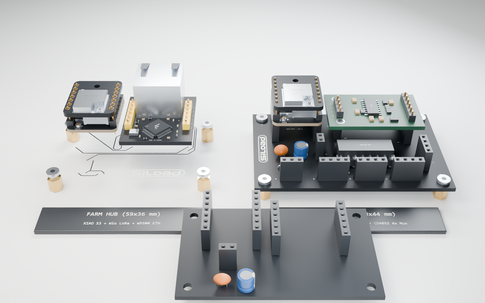

# SILOAD LOAD CELL REV A — Silo Unit Carrier PCB (`68 × 44 mm`)

Zie [`ONTWERP.md`](ONTWERP.md) en [`../PINOUT.md`](../PINOUT.md) voor het volledige aansluitschema, de waarheidstabel van de `CD4052BE` multiplexer (`U1`) en de BOM (`BOM.csv`).
